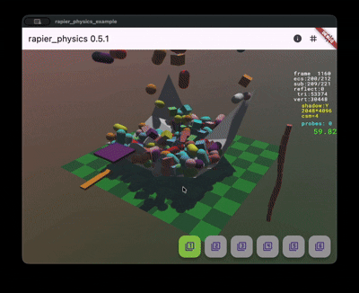

# Rapier Physics for Flutter (繁體中文)

[](https://pub.dev/packages/rapier_physics)
[](https://opensource.org/licenses/MIT)


這是一個基於 [Rapier](https://rapier.rs/) 的 Flutter 高性能物理引擎。此套件透過 Rust 和 WebAssembly 提供 3D 物理模擬的跨平台支持。

[**網頁版線上展示**](https://macbearchen.github.io/rapier_physics/)



## 特色

- **跨平台**: 支持 Android、iOS、macOS、Windows 和 Web。
- **高性能**: 核心物理模擬使用 Rust 編寫。
- **靈活的物理**: 支持多種剛體類型（動態 Dynamic、固定 Fixed、運動學 Kinematic）。
- **角色控制器 (Character Controller)**: 支持台階自動跨越、斜坡滑行、貼地吸附與動態物體衝量推擠。
- **場景查詢 (Scene Queries)**: 射線檢測 (`castRay`, `castRayAndGetNormal`, `intersectionWithRay`, `intersectionsWithRay`) 與形狀檢測 (`castShape`, `intersectionsWithShape`)，支持過濾標記。
- **力與衝量**: 完整支持 `addForce`、`applyImpulse` 及其 `AtPoint` 變體。
- **速度控制**: 直接設定線速度與角速度，實現精確的物理狀態控制。
- **碰撞體 (Colliders)**: 支持方塊 (Box)、球體 (Sphere)、圓柱體 (Cylinder)、軸向膠囊體 (`capsuleX`, `capsuleY`, `capsuleZ`)、圓錐體 (Cone) 和 **高度場 (Heightfield)**，並支持**原生局部變換** (`localPosition`, `localRotation`)。
- **關節支持 (Joints)**: 支持固定關節 (Fixed)、球形關節 (Spherical)、旋轉關節 (Revolute)、棱柱關節 (Prismatic) 和繩索關節 (Rope)，並支持馬達 (Motor)。
- **生命週期管理**: 提供完善的剛體、碰撞體與關節的 **新增與移除** API，並自動處理內部關連清理。
- **CCD**: 提供連續碰撞檢測 (Continuous Collision Detection)，防止高速物體穿透。
- **步進控制 (Timestep)**: 通過 `RapierWorld.timestep` 獲取與設定物理模擬的集成步進大小 (`dt`)。
- **現代 Web 支持**: 使用 `dart:js_interop` 實現高效的 WASM 調用。
- **現代 Apple 平台整合**: 完整支持 Swift Package Manager (SPM) 與 CocoaPods。

## 開始使用

### 安裝 (Installation)

在您的 `pubspec.yaml` 中添加 `rapier_physics` 依賴：

```yaml
dependencies:
  rapier_physics: ^0.5.2
```

### 設置

請選擇以下其中一種方法來設置原生庫：

#### 1. 使用預編譯庫 (Prebuilt Library)
如果您不想從源碼編譯，可以使用倉庫中提供的預編譯二進制文件。

#### 2. 自行編譯 (Build by Yourself)
若要從源碼編譯庫，請按照以下步驟操作：

**安裝 Cargo**
- 2-1. `curl https://sh.rustup.rs -sSf | sh`
- 2-2. `source $HOME/.cargo/env`
- 2-3. `cargo --version`

**編譯庫**
- 2-4. `cd native/rapier_ffi`
- 2-5. `./build.sh`

此腳本將執行以下操作：

- 編譯適用於 Android 的 `.so` 文件並放入 `android/src/main/jniLibs`。
- 編譯適用於 iOS/macOS 的 `.a` 文件，包裝成 `.xcframework` 並發布到各自平台子目錄以支持 Swift Package Manager (SPM)。
- 編譯適用於 Windows 的 `.dll` 文件（需在 Windows 主機上執行）並放入 `prebuilt/` 目錄。
- 編譯適用於 Web 的 `.wasm` 並放入範例專案中。

### 基本用法

初始化 `RapierWorld` 並開始模擬：

```dart
import 'package:rapier_physics/rapier_physics.dart';

void main() async {
  // 1. 初始化世界（異步以支持 WASM）
  final world = RapierWorld();
  await world.init();

  // 2. 添加一個固定的地板
  world.addBox(
    hx: 10.0, hy: 0.1, hz: 10.0, 
    desc: RigidBodyDesc.fixed()..position = Vector3(0, 0, 0)
  );

  // 3. 添加一個動態掉落的方塊
  final box = world.addBox(
    hx: 0.5, hy: 0.5, hz: 0.5,
    desc: RigidBodyDesc.dynamic()..position = Vector3(0, 10, 0)
  );

  // 4. 在遊戲循環中執行模擬步進
  Timer.periodic(Duration(milliseconds: 16), (timer) {
    world.step();
    print('方塊位置: ${box.position}');
  });
}
```

### 3D 互動範例 (3D Interactive Demos)

範例專案中包含多個使用 [macbear_3d](https://pub.dev/packages/macbear_3d) 渲染引擎開發的 3D 互動範例，並透過 `M3RapierPhysicsEngine` 與物理引擎進行整合。

運行 3D 物理模擬範例命令：

```bash
cd example
flutter run -t lib/main_3d.dart
```

這些範例包括：
1. **基礎物理場景 (Basic Physics Scene)**：展示各種剛體（方塊、球體、圓柱體、膠囊體、圓錐體）的碰撞、重力動態，以及一個互動的馬達旋轉關節。
2. **牛頓擺 (Newton's Cradle)**：使用球形關節約束模擬動量守恆。
3. **雙擺 (Double Pendulum)**：使用旋轉與球形關節模擬混沌運動。
4. **複合形狀 (Compound Shapes)**：由多個碰撞體組成的單個剛體（例如具有四隻腳的桌子）。
5. **角色控制器 (Character Controller)**：3D 玩家角色移動、台階跨越、斜坡滑行與動態障礙物推擠。
6. **場景查詢 (Scene Queries)**：動態射線與形狀檢測、射線交點可視化與碰撞過濾。

## 支持的剛體類型 (Rigid Body Types)

- `RigidBodyType.dynamic`: 由物理引擎完全模擬。
- `RigidBodyType.fixed`: 靜態物體，不會移動。
- `RigidBodyType.kinematicPositionBased`: 通過設置位置來移動。
- `RigidBodyType.kinematicVelocityBased`: 通過設置速度來移動。

## 專案結構

- `lib/`: Dart 源代碼和綁定邏輯。
- `native/rapier_ffi/`: 用於物理橋接的 Rust 源代碼。
- `example/`: Flutter 範例應用程式。

## 許可證

本專案採用 MIT 許可證。
